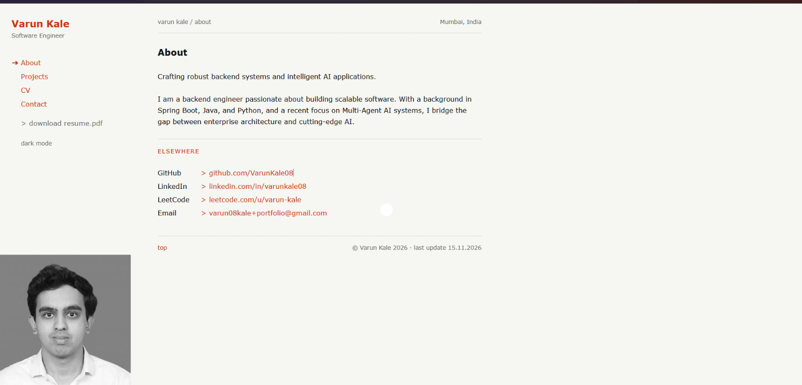
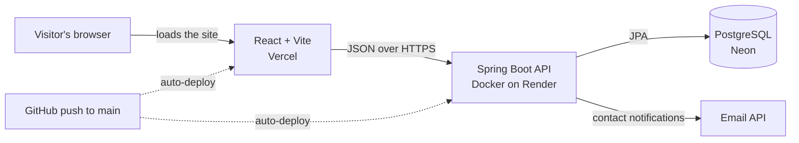

# Portfolio

My personal portfolio: a React site backed by a REST API I built with Spring Boot.

**Live site:** https://varunkale.vercel.app
**API:** https://portfolio-gn17.onrender.com/api/profile



## Architecture



All content (profile, projects, experience, education, publications, skills) lives in
PostgreSQL and is served by the API. The frontend holds no content of its own.

## Tech stack

| Layer | Tools |
|---|---|
| Backend | Java 25, Spring Boot 4, Spring Data JPA, Flyway, Bean Validation |
| Database | PostgreSQL 18 |
| Frontend | React, TypeScript, Vite, React Router |
| Testing | JUnit, Mockito, MockMvc |
| Deployment | Docker, Render, Neon, Vercel |

## Backend features

- Layered design: controller, service, repository, with DTO records
- Database schema and content versioned as Flyway migrations
- Consistent error responses using RFC 9457 `ProblemDetail`
- Contact form with server-side validation, email notification and per-IP rate limiting
- Request logging with a Spring AOP aspect
- CORS restricted to the frontend's origin
- Health endpoint used as the deployment health check

## API

| Method | Path | Returns |
|---|---|---|
| GET | `/api/profile` | Name, title, about text and links |
| GET | `/api/projects` | All projects |
| GET | `/api/projects/{slug}` | One project |
| GET | `/api/experience` | Work experience with highlights |
| GET | `/api/education` | Degrees |
| GET | `/api/publications` | Publications |
| GET | `/api/skills` | Skills grouped by category |
| GET | `/api/resume` | Resume as a PDF |
| POST | `/api/contact` | Saves a message and sends a notification |
| GET | `/actuator/health` | Service health |

## Run it locally

Requirements: Java 25, Node.js 22 or newer, Docker Desktop.

Backend (starts PostgreSQL in Docker automatically, on port 5433):

```bash
cd backend
./mvnw spring-boot:run
```

Frontend, in a second terminal:

```bash
cd frontend
npm install
npm run dev
```

The site runs at http://localhost:5173 and the API at http://localhost:8080.

## Tests

```bash
cd backend
./mvnw test
```

## Project structure

```
portfolio/
├── backend/    Spring Boot API, migrations, Dockerfile
└── frontend/   React site
```